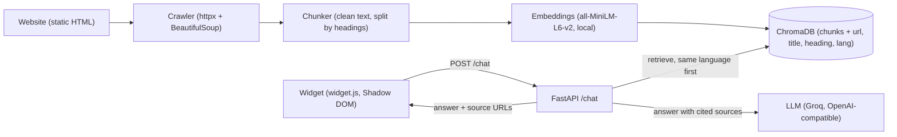

# site-chat-widget

A RAG chatbot widget for websites. It crawls a site, indexes its pages, and
answers visitors' questions **only from that site's content**, in English or
French, with a numbered link to every page it used. It ships as one
`<script>` tag.

The demo runs on **Fleuve Immobilier, a FICTIONAL real estate agency in
Montréal** (`demo_site/`): every name, price, listing, address and phone
number in it is invented, and the site and widget say so.

## Architecture



1. **Crawler** (`app/crawler.py`): follows same-site links from a start URL (up to `MAX_PAGES`), respects robots.txt.
2. **Chunker** (`app/chunker.py`): drops navigation, header, footer, scripts and form controls, keeps headings, and splits each page into overlapping chunks under their heading path.
3. **Indexer** (`app/indexer.py`): embeds title + heading + text locally and stores them in ChromaDB, with `lang` = `fr` for pages under `/fr/`, else `en`.
4. **RAG** (`app/rag.py`): detects the question's language, searches with the question (and its English translation for French questions), ranks chunks in the question's language first (other-language chunks only fill in when fewer than 3 match), then asks the LLM to answer from the numbered sources only.
5. **API** (`app/main.py`): `POST /chat`, `GET /health`; also serves the demo site at `/` and the widget at `/widget/widget.js`.
6. **Widget** (`widget/widget.js`): vanilla JS, no build step, isolated in a Shadow DOM; bilingual, keyboard accessible, conversation kept across pages for the session.

## Stack

Python 3.11+, FastAPI, Uvicorn, httpx, BeautifulSoup, sentence-transformers (`all-MiniLM-L6-v2`, runs on CPU), ChromaDB, the `openai` client against Groq's OpenAI-compatible API (`openai/gpt-oss-120b` or `-20b`), pytest. Widget: vanilla JavaScript. Demo site: static HTML/CSS with GSAP + Lenis.

## Setup

```bash
python3.11 -m venv venv
source venv/bin/activate            # Windows: venv\Scripts\activate
pip install -r requirements.txt

cp .env.example .env
# edit .env: set GROQ_API_KEY (free key at https://console.groq.com/keys)
```

`.env` holds your API key: **never commit it** (it is in `.gitignore`).
`OPENAI_API_KEY` is accepted as an alias of `GROQ_API_KEY`, and any
OpenAI-compatible provider works through `OPENAI_BASE_URL` and `LLM_MODEL`
(see `.env.example`).

## Commands

```bash
# Run the API; it also serves the demo site on the same port
uvicorn app.main:app --port 8000

# Crawl and index the site (in a second terminal). Index from port 8000 so
# source links point to the pages the API serves. Restart the API afterwards
# so it loads the new index.
python -m app.indexer build http://localhost:8000/index.html

# Ask from the command line, or inspect what search finds
python -m app.rag "What is your commission when I sell?"
python -m app.indexer search "documents to rent"

# End-to-end tests (10 EN/FR questions against the running API)
pytest -v

# Same questions as a report: prints a table, writes eval_results.md and
# refreshes the table below
python scripts/run_eval.py
```

If indexing or startup hangs on a machine without network, the embedding
model is already cached: set `HF_HUB_OFFLINE=1`.

## Embed the widget

One tag before `</body>`:

```html
<script src="https://your-api.example.com/widget/widget.js"
        data-api="https://your-api.example.com"
        data-title="Your Company"
        data-color="#8b6d47"
        data-lang="auto"
        defer></script>
```

Optional attributes: `data-suggestions="Q1|Q2|Q3"` and `data-suggestions-fr`,
`data-label` / `data-label-fr` (launcher text), `data-theme="light|dark"`,
`data-font="Family name"` (a font the page already loads) and
`data-font-src` (a woff2 URL to load it). Text colours are derived from
`data-color` so they keep WCAG AA contrast whatever the brand colour.

API: `POST /chat` with `{"question": "...", "history": [{"role": "user", "content": "..."}]}`
returns `{"answer": "...", "sources": [{"n", "title", "heading", "url"}], "error": null}`.

## Limitations

- **Static HTML only for now**: the crawler reads the HTML the server sends and runs no JavaScript, so content rendered client-side (React/Vue SPAs) is not indexed.
- **Free-tier rate limits**: Groq's free plan allows about 30 requests/min, 1,000/day and a few thousand tokens/min. A French question costs two LLM calls (search translation + answer). Past the limit the widget shows a "try again in a minute" message; the tests and eval retry after a wait.
- Re-indexing is manual (`python -m app.indexer build ...`), followed by an API restart.
- Language support is English and French; the language of a page comes from its URL (`/fr/`).
- The embedding model is mostly English, which is why French questions are also searched with an English translation.

## Evaluation

10 questions (5 English, 5 French) run against the live API. Each checks
HTTP 200, a non-empty answer, an answer in the question's language, and the
expected source page or keyword (or a refusal with no sources for
off-topic questions). Cases live in `tests/questions.py`.

<!-- eval:start -->
10/10 passed, run 2026-11-10 12:04 against http://localhost:8000

| Question | Result | Latency (s) | Sources |
| --- | --- | ---: | --- |
| What documents do I need to rent? | pass | 1.5 | /rent.html |
| What is your commission to sell a house? | pass | 0.6 | /fees.html, /sell.html |
| Tell me about LI-002 | pass | 0.9 | /listings.html, /index.html, /neighborhoods.html |
| Which neighborhoods do you cover? | pass | 0.5 | /neighborhoods.html |
| Do you sell cars? | pass | 0.5 | none |
| Quels documents faut-il pour louer ? | pass | 1.1 | /fr/rent.html |
| Quelle est votre commission pour vendre ? | pass | 1.3 | /fr/sell.html, /fr/fees.html |
| Avez-vous un condo à Verdun ? | pass | 1.4 | /fr/listings.html |
| Comment vous contacter ? | pass | 1.8 | /fr/contact.html |
| Vendez-vous des voitures ? | pass | 1.5 | none |
<!-- eval:end -->

## Project structure

```
app/            config, crawler, chunker, indexer, rag, FastAPI app
widget/         widget.js (embeddable, no build step)
demo_site/      fictional Fleuve Immobilier site (EN + /fr/)
tests/          questions.py (cases + checks), test_questions.py (pytest)
scripts/        run_eval.py (evaluation report)
tools/          image generation, captures, demo-site build helpers
```
